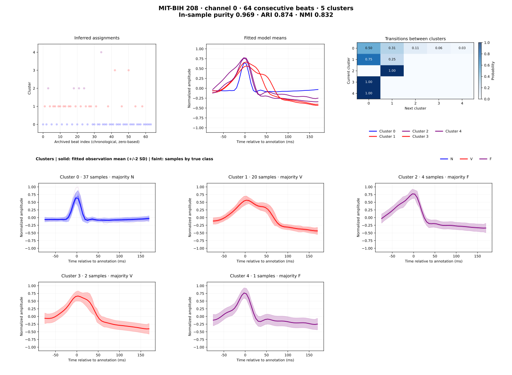

# HDP-GPC

**Bayesian clustering for waveform sequences, with Gaussian-process emissions,
latent dynamics, and hard or soft assignments.**

Use HDP-GPC to group observations such as ECG beats, sensor windows, or image
frames while modeling how their appearance changes over a sequence. The model
can create clusters during inference, subject to your HDP prior and cluster cap.
Optional alignment helps separate waveform shape from timing variation.

**Package:** `hdpgpc` · **Version:** 0.3.0 · **Python:** 3.10–3.12 ·
**License:** [GPL-3.0-only](LICENSE)

[Quickstart](#quickstart) · [Your data](#use-your-own-data) ·
[Soft assignments](#hard-and-soft-assignments) ·
[Dataset workflows](#run-a-dataset-experiment) · [Documentation](docs/README.md)

## What you can do

| Goal | Package support | Guide |
| --- | --- | --- |
| Cluster a complete recording or process observations as they arrive | Offline inference and online updates | [Tutorials](docs/tutorials.md) |
| Account for uncertain cluster membership | Hard or responsibility-weighted soft inference | [Assignment options](docs/configuration.md) |
| Model changes within a cluster | Gaussian latent states, LDS filtering/smoothing, configurable A/C and noise policies | [Model choices](docs/model_choices.md) |
| Cluster long waveforms or image-derived observations in a smaller state space | Fixed PCA, affine autoencoder, SFA, Fourier/wavelet decoders; learned MFA emissions | [Observation models](docs/fixed_observation_models.md), [MFA](docs/mfa_emission.md) |
| Use a common learned observation map across clusters | Shared MFA C and diagonal Sigma, with separate cluster means | [Shared MFA](docs/mfa_emission.md#shared-loadings-and-diagonal-noise) |
| Align waveforms or constrain temporal progression | Optional GP/DTW-GP/GP-flow alignment; left-to-right HMM stages | [Alignment](docs/alignment_choices.md), [ordered stages](docs/transition_topology.md) |

Choose these assumptions for your data: a left-to-right model enforces ordered
stages, and an alignment model can remove timing differences that might matter
to your application. Neither choice establishes the meaning of a cluster.

## Quickstart

From a checkout of this repository:

```sh
python -m venv .venv
# Linux/macOS:
source .venv/bin/activate
# Windows PowerShell: .venv/Scripts/Activate.ps1
python -m pip install --upgrade pip
python -m pip install .
hdpgpc-reference --check --output example_run.json
```

The command generates six synthetic waveforms, fits a small offline model, and
saves its configuration, labels, component summaries, and environment metadata.
No dataset download is needed. The installed command also works outside the
checkout. Use a new output filename for each run.

For CPU-only installations, see the [installation guide](docs/installation.md)
for choosing a PyTorch build before installing the package. For source
changes, use `python -m pip install -e '.[dev]'`.

The same example through Python:

```python
from hdpgpc import HDPGPC
from hdpgpc.examples import configuration, waveforms

X = waveforms()  # shape: (6 observations, 5 points, 1 output)
model = HDPGPC(configuration('offline')).fit(X)

print(model.labels_)       # one discrete label per observation
print(model.n_clusters_)   # occupied clusters, excluding empty reserved slots

cluster = int(model.cluster_ids_[0])
prediction = model.predictive(cluster)  # current observation distribution
state = model.posterior(cluster)[0]    # latest stored state for output 0
```

Bundled recipes use explicit toy-data hyperparameters. Configure a suitable
basis, kernel, noise scale, and inference budget for a real recording.
`predictive()` queries a fitted component's current observation distribution;
it does not assign a new observation or forecast its next time step.

### Try real ECG beats

```sh
python examples/ecg_quickstart.py --output-dir agents/ecg_quickstart/my_run
```

This runs a static Gaussian-process clustering model with **learned diagonal
observation noise per cluster** on **64 consecutive beats
from MIT-BIH record 208**, using channel 0 and 45 samples per beat. It uses local
data when available; otherwise it downloads about 4.3 MB from a pinned archive
and verifies the checksums. Only the core installation is needed.



The example found **5 clusters**: in-sample purity **0.969**, ARI **0.874**, and
NMI **0.832**. Annotations are used only for evaluation. The panels show every
cluster, including groups of one or two beats; annotation classes can split
across several clusters. The figure uses the MIT-BIH report layout, with fitted
means, consecutive-beat transitions and a three-column cluster gallery. Faint
traces retain their annotation colors; means and ±2 observation SD bands use
the cluster’s majority-label color. Assignment dots use that same pale band color.

Each run saves the figure, input subset, full configuration, assignments,
metrics, data checksums, dependency versions, and fitting log. See the
[ECG quickstart guide](docs/ecg_quickstart.md) for preprocessing, reproducibility,
and interpretation, or [MIT-BIH on PhysioNet](https://physionet.org/content/mitdb/1.0.0/)
for the source dataset. For complete recordings, use the
[full ECG runner](examples/mitbih_waveform_clustering.py).

The small synthetic reference remains available as an installation check; its
[figure generator](tools/plot_synthetic_reference.py) reproduces that workload.

## Hard and soft assignments

**Both inference modes are supported through the configuration API.**
`hard_assignments=True` is the default; set it to `False` to use fractional
state/transition responsibilities and responsibility-weighted Bayesian updates:

```python
from dataclasses import replace
from hdpgpc import HDPGPC
from hdpgpc.examples import configuration, waveforms

config = configuration('offline')
config = replace(config, inference=replace(
    config.inference, hard_assignments=False,
))
model = HDPGPC(config).fit(waveforms())
```

Dataset scripts expose the same choice as `--no-hard-assignments`. Soft
inference requires Bayesian parameter updates and can cost more because one
observation may contribute to multiple clusters.

Inference mode and returned summaries are separate: `labels_` is discrete in
both modes. The current streaming `UpdateResult.responsibilities` is a one-hot
summary, and `assignment_probabilities` is `None`; the facade does not yet expose
a full soft-responsibility matrix. See the [API assignment contract](docs/public_api.md#hard-and-soft-assignments)
for the distinction and current result-access limits.

## Use your own data

| Operation | One output | Multiple outputs |
| --- | --- | --- |
| `fit(X)` | `(observations, points)` or `(observations, points, 1)` | `(observations, points, outputs)` |
| `update(x)` | `(points,)` or `(points, 1)` | `(points, outputs)` |

Values must be finite numeric arrays. Pass waveform coordinates separately as
`grid`; observation order defines progression through the sequence. Configure
`n_outputs` when using multiple outputs.

For a single-output array `X`, an explicit starting recipe is:

```python
import numpy as np
from sklearn.gaussian_process.kernels import RBF
from hdpgpc import HDPGPC, HDPGPCConfig
from hdpgpc.config import (
    AlignmentConfig, DynamicsConfig, GPEmissionConfig, HDPConfig,
    InferenceConfig, NumericalConfig,
)

# Replace X with your (observations, points) waveform array.
# Use your actual sample coordinates if a normalized domain is inappropriate.
grid = np.linspace(0.0, 1.0, X.shape[1])[:, None]
config = HDPGPCConfig(
    x_basis=grid,
    emission=GPEmissionConfig(
        kernels=[RBF(length_scale=0.15)], fit_gp=False, ini_sigma=0.01,
    ),
    dynamics=DynamicsConfig(ini_gamma=0.01, lds_update='conjugate_batch'),
    alignment=AlignmentConfig(policy='none'),
    hdp=HDPConfig(max_models=12),
    inference=InferenceConfig(
        schedule='offline', offline_strategy='split_merge',
        hard_assignments=False, it_limit=20,
    ),
    numerics=NumericalConfig(seed=42, num_threads=1),
)
model = HDPGPC(config).fit(X, grid=grid)
```

The kernel length scale and noise **variances** above are illustrative, not
universal defaults. Start with a small subset and no alignment; inspect clusters
and convergence before increasing the budget. For longer observations, consider
an [observation decoder or reduced state basis](docs/model_choices.md#reduce-the-state-dimension).
See [typed configuration](docs/configuration.md) for priors and available policies.

## Process arriving observations

```python
from hdpgpc import HDPGPC
from hdpgpc.examples import configuration, waveforms

stream = HDPGPC(configuration('online'))
for x in waveforms()[:4]:
    result = stream.update(x)
    print(result.observation_index, result.assigned_cluster, result.new_cluster)
```

`fit()` starts a fresh model. To stream, create a separate online model; an
offline fit cannot be continued with `update()`. Cluster indices may change as
the model reallocates components. See the [public API](docs/public_api.md) for
result shapes, streaming behavior, and supported combinations.

## Run a dataset experiment

The repository includes runners for UCR time series, MIT-BIH ECG, Daphnet
sensor windows, CAS-Colon frames, zebrafish/Xenopus expression snapshots, and synthetic
image sequences. Dataset files
are obtained separately; inspect each runner's `--help` and data-layout guide.

```sh
python -m pip install '.[datasets,images,yaml]'
python examples/ucr_pca_clustering.py --help
python examples/cas_colon_mfa_clustering.py --help
```

For example, with CAS-Colon already extracted locally:

```sh
python examples/cas_colon_mfa_clustering.py \
  --data-dir /path/to/CAS-ColonDB --records 29 \
  --shared-emission --dynamic --hmm-switch \
  --transition-topology left_to_right --max-series 100 --lds-plots
```

Runs save configuration, logs, assignments, label metrics, and diagnostic
artifacts. CAS-Colon also reports a matched-cluster-count equal-duration
baseline beside model metrics. Anatomical majority labels are evaluated in
sample; use independent evaluation before drawing application conclusions.
Shared MFA currently requires CPU and offline batch updates.

| Start from | Guide |
| --- | --- |
| Common script arguments and saved results | [Experiment workflows](docs/experiment_workflows.md) |
| Complete sensor/ECG records | [Record workflow](docs/record_workflow.md) |
| CAS-Colon observations and learned MFA | [Image workflow](docs/cas_colon_pca.md), [MFA](docs/mfa_emission.md) |
| All-gene zebrafish expression states, independent versus evolving factors | [Zebrafish workflow](docs/zebrafish_workflow.md) |
| Denser Xenopus expression trajectories and independent clutches | [Xenopus workflow](docs/xenopus_workflow.md) |
| Fixed PCA or autoencoder observations for either expression dataset | [Expression representations](docs/expression_representations.md) |
| Executable notebooks | [Notebook suite](tutorials/README.md) |

For notebook tools, install `python -m pip install '.[examples,tutorials]'`.

## Reproducibility and development status

Save the full configuration, source/version identifier, seed, and dependency
environment with each experiment. CPU float64 is the characterized reference
path; configuration support and numerical reproducibility depend on the chosen
schedule and observation model. Consult the [reproducibility guide](docs/reproducibility.md)
and [installation notes](docs/installation.md).

The bundled reference pins its HDP concentrations and inference policies explicitly.
`hdpgpc-reference --check` verifies the recipe and data hashes, exact cluster
assignments, and numerical outputs against a versioned snapshot. See
[reference history and tolerances](docs/reproducibility.md#reference-version-2).

For the public interface, start with [API documentation](docs/public_api.md).
For available formulations, use [model choices](docs/model_choices.md). The
[documentation index](docs/README.md) contains the technical guides;
[CHANGELOG.md](CHANGELOG.md) and the [migration guide](docs/migration.md) cover
changes from older versions, including the retired 0.2 entry points and pickle paths.

## License and citation

Developed by Adrián Pérez Herrero. Licensed under
[GPL-3.0-only](LICENSE). Adapted bnpy routines retain their BSD attribution;
see [NOTICE.md](NOTICE.md) and [licenses/bnpy.txt](licenses/bnpy.txt).
Use [CITATION.cff](CITATION.cff) to cite the software and record the version or
Git commit used for your experiment.
